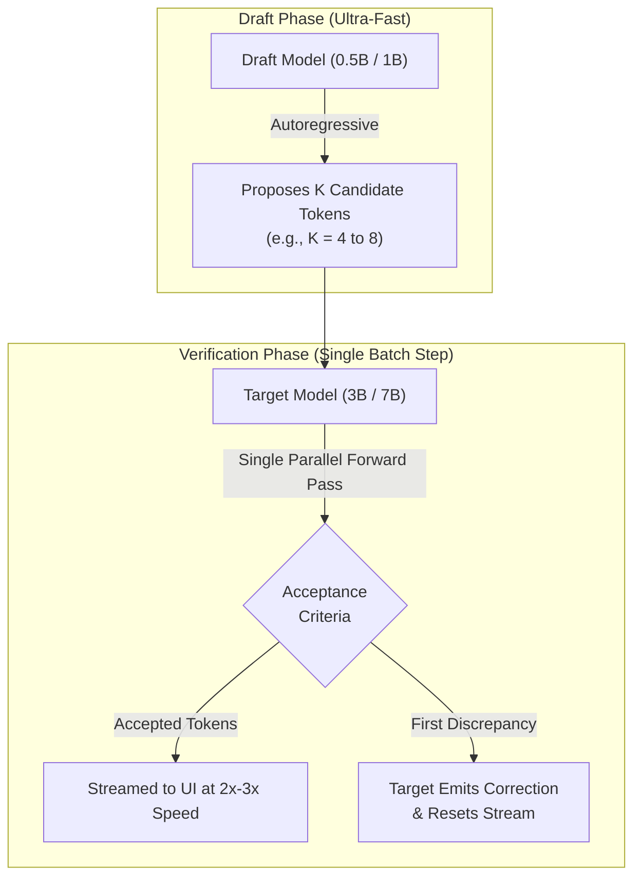
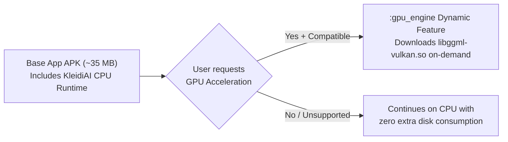
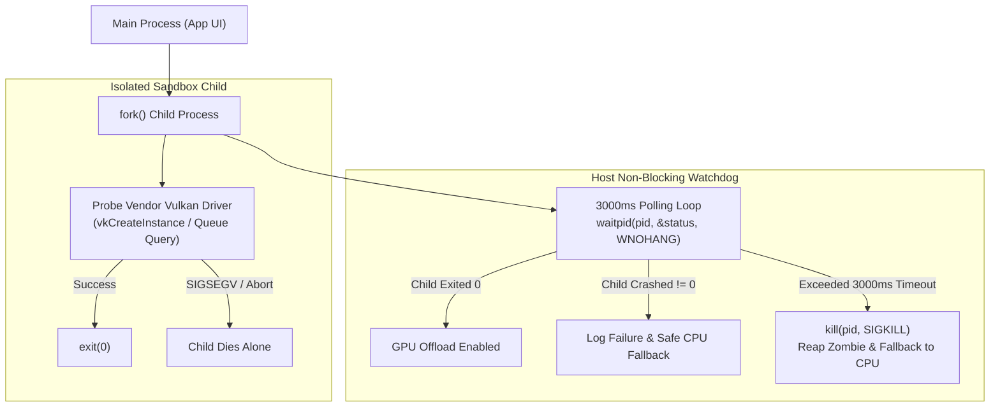
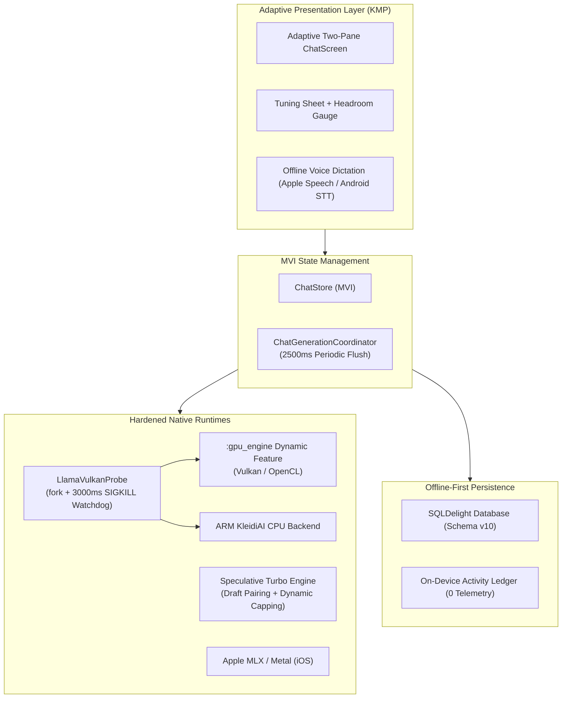

+++
title = "Part 6 - Pushing Mobile Hardware to the Edge"
date = "2026-10-21T15:30:00+05:30"
description = "Dual-model speculative decoding, on-demand GPU dynamic delivery, isolated driver crashes, and streaming fault-tolerance."
tags = ["Android", "iOS", "On-Device AI", "llama.cpp", "Kotlin Multiplatform", "Speculative Decoding", "Vulkan", "NDK", "Performance"]
series = ["Beyond the Model"]
[author]
  name = "Dhruv Patel"
+++

# Pushing Mobile Hardware to the Edge

## Part 6 - Dual-model speculative decoding, on-demand GPU dynamic delivery, isolated driver crashes, and streaming fault-tolerance.

When you run open-source large language models on desktop GPUs, latency is rarely the bottleneck that keeps you awake at night. You have 24 GB of VRAM, 300 watts of wall power, and active cooling fans.

On a smartphone, you have:

```text
a shared SoC memory pool
thermal throttling within minutes
aggressive OS process killers (Android LMK)
fragmented GPU drivers
a strict battery budget
```

In [Part 3](./03-the-model-was-fine-the-phone-wasnt.md), we explored memory admission, quantization tradeoffs, and thermal guardrails. In [Part 5](./05-at-some-point-i-stopped-building-a-chat-app.md), we established an MVI Clean Architecture to coordinate these moving parts.

Once the foundational architecture was stable, a new reality emerged:

> **Users don't just want a local model that fits in memory. They expect it to feel fast, reliable, and indestructible.**

If a 3B model generates text at 6 tokens per second on CPU, multi-turn conversations feel sluggish. If an unverified vendor GPU driver segfaults during startup, the entire application vanishes from the screen. And if the user receives a phone call while the model is halfway through a 500-token answer, that generation cannot simply disappear into the void.

This is the story of how we pushed mobile hardware to the edge in **AI Playground v1.7.x**-implementing dual-model speculative decoding, dynamic on-demand GPU delivery, isolated process crash guards, and streaming fault-tolerance.

---

# 1. The Generation Speed Ceiling

On mobile devices, LLM decoding is predominantly **memory-bandwidth bound**.

Every single generated token requires reading billions of model parameters from DRAM into the processor cache:

```text
Memory bandwidth required = Model Size (Bytes) × Tokens per Second
```

For a 4-bit quantized 3B parameter model (~2.0 GB):
* At 10 tokens/sec, the memory bus must transfer **20 GB/s** continuously.
* On high-end mobile SoCs, peak memory bandwidth is shared between the CPU, GPU, NPU, ISP, and display engine.

Even with GPU offload via Vulkan or Metal, sequential auto-regressive generation hits a thermal and bandwidth ceiling.

How do you break past this ceiling without increasing clock speeds or melting the battery?

**Answer: Speculative Decoding.**

---

# 2. Speculative Turbo: Two Models, One Screen

The core intuition behind speculative decoding is simple:

> **Generating tokens sequentially is expensive. Verifying tokens in parallel is cheap.**

Instead of letting our primary model (the **Target Model**, e.g., Llama 3.2 3B) generate every token one by one, we introduce a secondary, ultra-compact companion model (the **Draft Model**, e.g., Qwen 2.5 0.5B or Llama 3.2 1B).



The draft model runs at 40–60 tokens per second, quickly drafting a sequence of $K$ candidate tokens. The target model then runs a **single batched forward pass** evaluating all $K$ tokens at once.

If the target agrees with 4 of the candidate tokens, we have advanced 4 tokens in the time it would normally take to generate just 1.5 tokens.

### The Mobile Engineering Catch

On a server, speculative decoding is a matter of spinning up another GPU process. On a phone, it presents three severe hazards:

1. **VRAM / Unified Memory Exhaustion**: Loading two separate model weights plus two separate KV caches can instantly blow past the Android OS low-memory killer (LMK) threshold.
2. **Draft Context Bloat**: If the draft model allocates a standard 4096 or 8192 context buffer, unified memory spikes by hundreds of megabytes before a single token is drafted.
3. **Draft Self-Pairing**: Accidentally pairing a model with itself or an incompatible tokenizer family creates infinite verification failures.

### The Solution: ADR-202 Hardware Guardrails

In `llama_engine.cpp` and our Kotlin domain layer, we codified strict invariants:

#### A. Dynamic Draft Context Capping
We cap the draft model's context window and batch size strictly to minimum necessary bounds:

```cpp
// Prevent VRAM exhaustion during dual-model loading
uint32_t draft_n_ctx = std::min(2048u, llama_n_ctx(handle->target_context));
uint32_t draft_n_batch = std::min(512u, llama_n_batch(handle->target_context));
```

#### B. Hardware RAM Admission Tiers
We reject Speculative Turbo activation on devices with less than 6 GB RAM, and gate allowable draft sizes on 6–8 GB devices:

```kotlin
fun isSpeculativeTurboEligible(totalRamGb: Int, draftSizeBytes: Long): Boolean {
    if (totalRamGb < 6) return false
    val draftMb = draftSizeBytes / (1024 * 1024)
    return when {
        totalRamGb >= 12 -> true
        totalRamGb >= 8 -> draftMb <= 1500
        totalRamGb >= 6 -> draftMb <= 800
        else -> false
    }
}
```

#### C. Proactive KV Cache Pre-Warming
When a chat thread loads, `KvCacheSessionManager` proactively pre-warms the session state so dual-model generation starts without thread-switch stutter.

The result? On compatible devices, generation throughput jumps from **9–12 tok/s to 22–28 tok/s** for common conversational queries, while memory consumption remains safely within bounds.

---

# 3. Dynamic On-Demand GPU Delivery

AI Playground supports multiple hardware backends:
* **ARM KleidiAI CPU backend** (ARMv9.2 vector acceleration)
* **Vulkan GPU compute** (Android Qualcomm Adreno & ARM Mali)
* **OpenCL compute** (select Android platforms)
* **Apple Metal & MLX** (iOS)

Initially, bundling native GPU runtime libraries (`libggml-vulkan.so`, `libggml-opencl.so`, shaders, and dependencies) added over 50 MB to the base APK download size.

Worse yet: GPU compute is not universal. Some budget chips have incomplete Vulkan SPIR-V implementations, and shipping monolithic GPU binaries penalizes users who only run CPU inference.

### The Solution: Play Feature Delivery (`:gpu_engine`)

We decomposed the engine into a modular dynamic feature module:



1. **Lightweight Base**: The primary application ships lean with optimized ARM KleidiAI CPU kernels.
2. **On-Demand Install**: When the user opts into GPU acceleration, the application requests the `:gpu_engine` module via Google Play Core split install APIs.
3. **Timestamp Verification**: Custom Gradle tasks verify recompiled binary hashes and timestamps before packaging, ensuring staging integrity.

---

# 4. The Vendor Driver Trap: Isolated Crash Protection

Every mobile systems engineer knows this painful truth:

> **Android GPU drivers run in your application process. If a vendor driver crashes, your app crashes.**

During hardware detection, calling `vkCreateInstance()` or querying physical device extensions on certain OEM driver versions does not throw a clean exception. It triggers a hardware `SIGSEGV` or `SIGILL` deep inside proprietary driver `.so` files:

```text
Fatal signal 11 (SIGSEGV), code 1 (SEGV_MAPERR), fault addr 0x0 in tid 12345 (Thread-pool)
```

In standard Android user space, a native signal 11 inside your process **terminates the app immediately**. No `try-catch` block can save you.

Even worse: on certain custom vendor builds, driver initialization doesn't crash-it enters an **uninterruptible deadlock**. A standard blocking `waitpid()` will hang the main thread indefinitely.

### The Solution: Fork Isolation with a SIGKILL Watchdog (ADR-203)

To guarantee zero host crashes, we built an isolated hardware probe in `llama_engine.cpp`:



Here is the hardened probing logic implemented in native C++:

```cpp
bool LlamaVulkanProbe::probeVulkanWorks() {
    pid_t pid = fork();
    if (pid < 0) {
        // Fork failed; safely decline GPU offload
        return false;
    }

    if (pid == 0) {
        // In child process: isolate vendor driver execution
        signal(SIGSEGV, SIG_DFL);
        signal(SIGABRT, SIG_DFL);
        bool ok = performRawVulkanProbe();
        _exit(ok ? 0 : 1);
    }

    // In parent process: non-blocking polling watchdog
    const int max_wait_ms = 3000;
    const int poll_interval_ms = 20;
    int elapsed_ms = 0;
    int status = 0;

    while (elapsed_ms < max_wait_ms) {
        pid_t res = waitpid(pid, &status, WNOHANG);
        if (res == pid) {
            // Child exited cleanly; inspect exit code
            return WIFEXITED(status) && (WEXITSTATUS(status) == 0);
        }
        usleep(poll_interval_ms * 1000);
        elapsed_ms += poll_interval_ms;
    }

    // Driver deadlocked! Terminate child process with extreme prejudice
    kill(pid, SIGKILL);
    waitpid(pid, &status, 0); // Reap zombie process
    LOGW("Vulkan probe timed out after 3000ms. Falling back safely to CPU.");
    return false;
}
```

If the vendor driver segfaults, only the child process dies. If the vendor driver hangs, the watchdog sends `SIGKILL` after 3 seconds. The main application never drops a frame, and smoothly falls back to ARM KleidiAI CPU execution.

---

# 5. Streaming Fault-Tolerance & Interrupted Recovery

On-device inference takes time. Generating a thoughtful 500-token response on a mid-range phone can take 20 to 30 seconds.

During those 30 seconds, real life happens:
* The phone rings.
* The user switches to their browser.
* The device runs low on memory and the OS reclaims the background process.

In naive chat implementations, the generation is lost completely. When the user reopens the app, the conversation shows a blank response or a frozen spinner.

### The Solution: Periodic Mid-Stream Flushing (ADR-203, T-460)

We introduced a streaming persistence coordinator in our MVI presentation architecture:

1. **Periodic SQLite Snapshots**: While the token generator emits updates, `ChatGenerationCoordinator` flushes partial assistant text to SQLite at fixed intervals (`STREAM_PERSIST_INTERVAL_MS = 2500ms`).
2. **Process Death Recovery**: If the application restarts or crashes mid-stream, `ChatThreadManager.recoverInterruptedReply()` inspects active threads.
3. **Clean Degradation**: Unfinished responses are not discarded. They are marked as `PARTIAL_FAILED` with the exact text accumulated up to the last flush intact, alongside a prominent **Resume Generation** CTA.

```kotlin
// Cleanly finalize interrupted streaming turns upon startup
suspend fun recoverInterruptedReply(threadId: String) {
    val thread = chatRepository.getThread(threadId) ?: return
    val lastMessage = thread.messages.lastOrNull() ?: return

    if (lastMessage.status == MessageStatus.IN_FLIGHT) {
        val updatedMessage = lastMessage.copy(
            status = MessageStatus.PARTIAL_FAILED,
            failureReason = "Generation interrupted by process termination"
        )
        chatRepository.updateMessage(updatedMessage)
    }
}
```

---

# 6. Privacy-First Tracking: The On-Device Activity Ledger

Most mobile applications track engagement by pinging telemetry servers (Mixpanel, Firebase, Amplitude).

For an application built on the promise that **zero data leaves your phone**, sending analytic payloads to a server-even anonymized ones-violates user trust (`INV-OFFLINE-01`).

Yet users love having personal milestones:
* *How many tokens did I process locally this week?*
* *How many images did I synthesize?*
* *How many consecutive days have I used my private models?*

In v1.7.3, we implemented an **On-Device Activity Ledger** using pure Kotlin SQLDelight (schema v10):

```sql
-- UserActivity.sq
CREATE TABLE UserActivityEntity (
    id TEXT PRIMARY KEY NOT NULL,
    totalTokensProcessed INTEGER NOT NULL DEFAULT 0,
    activeDaysCount INTEGER NOT NULL DEFAULT 0,
    lastActiveTimestamp INTEGER NOT NULL DEFAULT 0,
    modelsLoadedCount INTEGER NOT NULL DEFAULT 0,
    imagesGeneratedCount INTEGER NOT NULL DEFAULT 0
);
```

* **100% Local**: All metrics are computed and stored in an isolated SQLite table strictly on `Dispatchers.IO`.
* **Zero Telemetry**: No network endpoints exist in the codebase.
* **Milestone Detection**: `ConversionTriggerEvaluator` detects user milestones (`POWER_USER_TOKENS`, `CONTEXT_CEILING_HIT`, `MODEL_COLLECTOR`) entirely on-device, unlocking badges and recommendations with a 48-hour cooldown.

---

# 7. Real-Time Token Headroom Monitoring

As conversations grow, users frequently wonder:
> *How close am I to filling up the model's context window?*

If a model has a 2048 or 4096 context window, and the combined prompt + history hits 2040 tokens, the next turn will either truncate earlier messages or trigger an out-of-context error.

In our latest chat tuning sheet, we integrated real-time token estimation directly into the UI state contract:

```kotlin
val contextUsageFraction: Float
    get() {
        val limit = contextLimitTokens
        if (limit <= 0) return 0f
        return (contextUsageTokens.toFloat() / limit.toFloat()).coerceIn(0f, 1f)
    }

val contextRemainingPercent: Int
    get() {
        val limit = contextLimitTokens
        if (limit <= 0) return 100
        return ((contextRemainingTokens * 100) / limit).coerceIn(0, 100)
    }
```

The user sees a visual headroom gauge showing exactly how much context remains before older messages must be compacted or summarized.

---

# Architecture Summary (v1.7.x)



---

# What We Learned

When you take AI off the cloud and put it on consumer hardware, you stop being just a machine learning engineer or an app developer.

You have to be both:
* You have to understand JNI memory layouts and C++ ABI parameter sizing.
* You have to understand how the Linux kernel schedules `fork()` and handles `waitpid()`.
* You have to respect mobile battery curves, thermal dissipations, and memory bus limits.
* And above all, you have to craft user interfaces that communicate runtime reality gracefully.

Open-source models are getting smaller and smarter every month. But **hardware resilience and runtime engineering are what make them truly usable.**

---

## The Complete Series

- [Part 1 - I Wanted the Model to Stay on the Phone](./01-i-wanted-the-model-to-stay-on-the-phone.md)
- [Part 2 - The Day a Chat Box Became a Document Engine](./02-the-day-a-chat-box-became-a-document-engine.md)
- [Part 3 - The Model Was Fine. The Phone Wasn't.](./03-the-model-was-fine-the-phone-wasnt.md)
- [Part 4 - I Put an Image Generator Inside the Phone](./04-i-put-an-image-generator-inside-the-phone.md)
- [Part 5 - At Some Point I Stopped Building a Chat App](./05-at-some-point-i-stopped-building-a-chat-app.md)
- **Part 6 - Pushing Mobile Hardware to the Edge**

**Project:** AI Playground  
**Website:** https://deardhruv.com  
**Repository:** https://github.com/DearDhruv/Model-Playground  
**Google Play:** [AI Playground on Play Store](https://play.google.com/store/apps/details?id=com.deardhruv.llmplayground)
