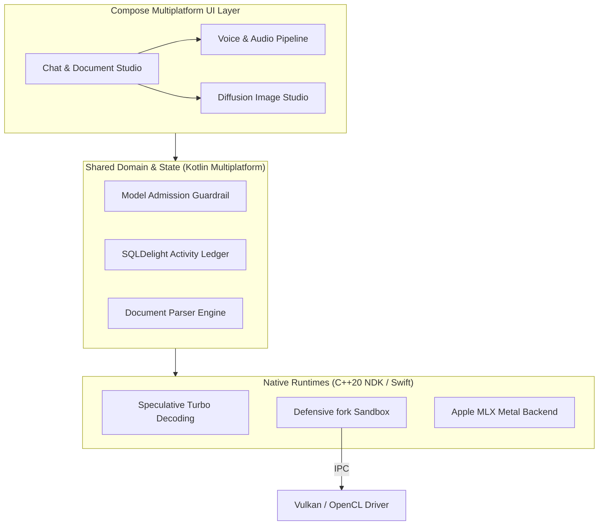

+++
title = "Engineering Projects & Case Studies"
date = "2026-10-21"
description = "In-depth technical case studies and architectural deep dives across Android architecture, Kotlin Multiplatform, on-device AI runtimes, and native systems engineering."
+++

This page documents selected engineering projects and case studies. Each entry covers the problem being solved, the constraints of the platform, the architecture chosen, and the technical trade-offs made along the way.

---

## 1. AI Playground — On-Device Multimodal AI Workstation

**Summary:** A privacy-first mobile workstation that runs multimodal LLMs and diffusion models locally on phones without cloud dependencies.  
**Role:** Director & Lead Engineer &middot; **Status:** Production (Google Play & GitHub)  
**Stack:** Kotlin Multiplatform, Compose Multiplatform, Modern C++20 / NDK (JNI), llama.cpp v0.7.0, Google AI Edge LiteRT, Apple MLX, Vulkan / OpenCL / Metal, SQLDelight  

### The Problem
Most AI applications depend entirely on cloud APIs. For users analyzing personal notes, proprietary code, or confidential spreadsheets, sending raw data to remote servers introduces serious privacy concerns, recurring subscription costs, and requires a continuous network connection. I built AI Playground to explore how far consumer phones could be pushed as self-contained, offline-first inference engines.

### Platform Constraints & Trade-Offs
- **Memory Pressure:** Mobile operating systems terminate processes that spike memory beyond strict system thresholds (Android Low Memory Killer / iOS Jetsam).
- **GPU Driver Fragility:** Vendor Vulkan drivers across heterogeneous Android chipsets frequently encounter segmentation faults during shader compilation.
- **Thermal Ceilings:** Sustained matrix multiplication triggers aggressive kernel thermal downclocking within 60 to 90 seconds if compute pipelines are unthrottled.

### Architecture Overview

### Engineering Decisions & Implementation
1. **Dual-Model Speculative Drafting:** Paired lightweight draft models (e.g., Qwen 2.5 0.5B) with larger target models (e.g., Llama 3.2 1B). Dynamic draft context capping (`std::min(2048u, ...)`) and KV cache session pre-warming produced a measured **2x decoding throughput improvement** on local silicon without exhausting VRAM.
2. **Defensive `fork()` Child Process Sandbox:** To prevent vendor GPU driver bugs from crashing the application, native driver probing runs inside an isolated child process with a 3000ms non-blocking watchdog and `kill(pid, SIGKILL)` fallback. If the driver faults, the child process exits cleanly while the host UI remains responsive.
3. **Pure-KMP Document Parsing Engine:** Extracts structured text across 25+ file formats (PDF, DOCX, XLSX, PPTX, CSV, JSON, Markdown, RTF) using pure RFC 1951 Deflate decompression, avoiding third-party native binaries or external web services.
4. **On-Device Diffusion:** Synthesizes 4-step diffusion images on mobile GPUs using Google LiteRT Multi-Graph runtime and Bonsai Image Ternary 4B with thermal throttling checks.
5. **100% Offline Activity Ledger:** Tracks local usage milestones via SQLDelight (schema v10) with strictly zero network calls (`INV-OFFLINE-01`).

### Links & Artifacts
- **Google Play:** [AI Playground on Google Play](https://play.google.com/store/apps/details?id=com.deardhruv.llmplayground)
- **Source Code:** [GitHub Repository](https://github.com/DearDhruv/Model-Playground)
- **Technical Series:** [Beyond the Model 6-Part Engineering Series](/posts/ai_playground_series/)

---

## 2. VelociHue — High-Framerate Arcade Game in KMP

**Summary:** A fast-paced arcade action game engineered to prove that Kotlin Multiplatform and Compose Multiplatform can deliver fluid 60–120 FPS gameplay across phones, tablets, and TVs.  
**Role:** Director & Lead Engineer &middot; **Status:** Production (Google Play)  
**Stack:** Kotlin Multiplatform, Compose Multiplatform, Kotlin 2.4.0, Target SDK 37 (Android 17), Cloud Firestore (Schema v5), Android TV (Leanback & D-pad)  

### The Problem
Cross-platform toolkits often struggle with consistent high-framerate rendering and low-latency input handling in timing-sensitive games. The objective of VelociHue was to build a commercial arcade title sharing 100% of game physics and progression logic while maintaining native-quality frame pacing across mobile and 10-foot television screens.

### Gameplay & User Experience
Players navigate high-speed color gates, matching shield frequencies against incoming hazards. The game demands precise reflexes, offering 29 progressive achievements across 1–5,000 player levels. An accessible sensory mode provides reduced-motion and photo-sensitive options for players sensitive to flashing visuals.

### Architecture & Technical Highlights
1. **Shared Pure-Kotlin Game Engine:** A deterministic physics loop (`GameEngine`, `CollisionDetector`) managing color-matching physics, projectiles, and power-ups across Android, iOS, and Android TV with zero duplicated logic.
2. **Conflict-Free Cloud Sync Engine (Schema v5):** Multi-device synchronization backed by Cloud Firestore with a 3-way union merge strategy that reconciles player progression, cosmetics, and active streaks across devices.
3. **Native Android TV Support:** Dedicated television deployment with Leanback manifest declarations and custom D-pad remote navigation focus states.
4. **Instant Compose Share Cards:** Run-summary share cards captured into high-resolution PNGs via Compose `GraphicsLayer.toImageBitmap()` and shared via Android `FileProvider`.

### Links & Artifacts
- **Google Play:** [VelociHue on Google Play](https://play.google.com/store/apps/details?id=com.deardhruv.velocihue)

---

## 3. Enterprise Digital Commerce Platform

**Summary:** Scalable mobile commerce systems handling high transaction volumes with sub-second checkout flows and offline-first catalog caching.  
**Role:** Lead Android Engineer &middot; **Status:** Production  
**Stack:** Kotlin, Jetpack Compose, Clean Architecture, MVI, Modular Gradle Architecture  

### Focus & Outcomes
- **Startup Latency:** Reduced cold application startup time by 40% utilizing Baseline Profiles, optimized R8 rule sets, and lazy coroutine dependency graphs.
- **Adaptive UI Architecture:** Engineered adaptive layouts supporting phone, tablet, foldable, and multi-window configurations using Jetpack Compose Window Size Classes.
- **Offline Integrity:** Designed a multi-tier caching layer ensuring cart persistence and uninterrupted product browsing during network dropouts.

---

## 4. POS & Peripheral Hardware Integration Layer

**Summary:** Resilient Hardware Abstraction Layer (HAL) connecting Android point-of-sale applications to 30+ physical retail peripherals.  
**Role:** Senior Developer & Mobile Architect &middot; **Status:** Production  
**Stack:** Kotlin, Android NDK, C++, Unix Domain Sockets, Peripheral USB/Bluetooth HAL  

### Focus & Outcomes
- **Connection Reliability:** Achieved 99.8% peripheral connection stability across thermal receipt printers, barcode scanners, payment terminals, and weight scales using defensive state machines and background watchdog services.
- **IPC Latency:** Reduced hardware communication latency by 60% through memory-mapped shared buffers and zero-copy IPC protocols.
- **Defensive Process Isolation:** Isolated peripheral communication across dedicated process boundaries to prevent peripheral firmware faults from taking down the main checkout flow.

---

## 5. Open Source Contributions & Project Archive

### Active Ecosystem Contributions
- **GitHub:** [@DearDhruv](https://github.com/DearDhruv)
- Focus areas: Kotlin Multiplatform tooling, on-device AI runtime bindings, Compose Multiplatform components, and performance profiling utilities.

### Archived Projects
- **Open Store App:** Open-source digital catalog application demonstrating clean architecture patterns in early Android development.
- **Architecture Sample Repos:** Open-source repositories demonstrating MVI patterns, Coroutine channels, and NDK JNI bridges.
