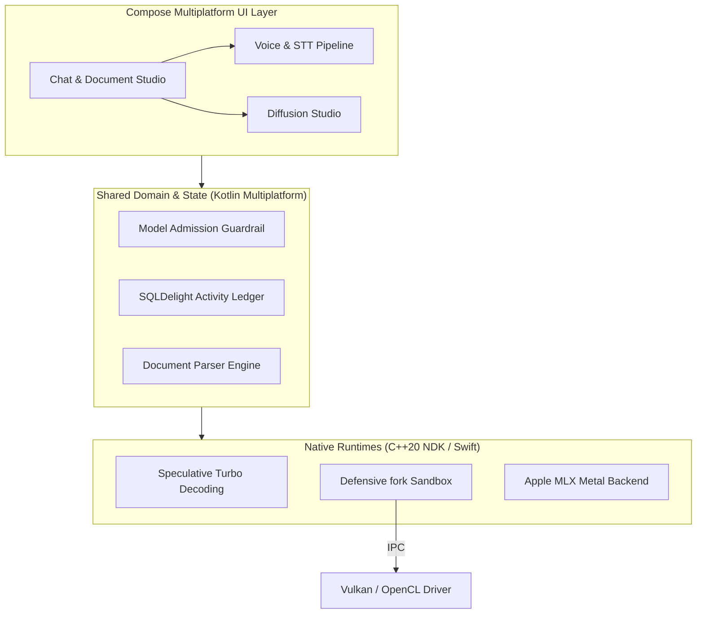

+++
title = "Engineering Projects & Case Studies"
date = "2026-10-21"
description = "In-depth technical case studies and architectural deep dives across Android architecture, Kotlin Multiplatform, on-device AI runtimes, and native systems engineering."
+++

This section documents detailed engineering case studies for production systems and open-source runtimes architected by Dhruv Patel. Each case study details constraints, architecture, trade-offs, and verified production results.

---

## 1. AI Playground — On-Device Multimodal AI Workstation

**Role:** Director & Lead Engineer &middot; **Status:** Production (Google Play & GitHub)  
**Stack:** Kotlin Multiplatform, Compose Multiplatform, Modern C++20 / NDK (JNI), llama.cpp v0.7.0, Google AI Edge LiteRT, Apple MLX, Vulkan / OpenCL / Metal, SQLDelight

### Context & Objective
Mainstream AI applications rely on cloud APIs, creating subscription costs, latency overhead, and severe privacy risks for confidential corporate documents and personal data. AI Playground was engineered to prove that consumer mobile devices can function as completely self-contained, high-performance multimodal AI workstations with zero cloud dependencies and 100% data privacy.

### Hardware & System Constraints
- **VRAM & RAM Ceilings:** Mobile OS process killers (Android Low Memory Killer / iOS Jetsam) terminate apps that exceed memory budgets.
- **Vendor GPU Driver Instability:** Heterogeneous Android GPU drivers (Adreno, Mali) frequently crash (SIGSEGV) when compiling Vulkan compute pipelines.
- **Thermal Throttling:** Sustained matrix multiplication triggers aggressive kernel thermal downclocking within 60 seconds.

### Architecture Overview

### Key Technical Decisions & Innovations
1. **Dual-Model Speculative Turbo Decoding:** Implemented speculative drafting pairing small draft models (e.g., Qwen 2.5 0.5B) with target models (e.g., Llama 3.2 1B). Dynamic draft context capping (`std::min(2048u, ...)`) and KV cache pre-warming yielded a **2x decoding throughput improvement** without VRAM exhaustion.
2. **Defensive `fork()` Child Process Sandbox:** To prevent proprietary vendor GPU driver bugs from terminating the host app, driver probing runs in an isolated child process with a 3000ms non-blocking watchdog and `kill(pid, SIGKILL)` fallback.
3. **Pure-KMP Document Parsing Engine:** Extracts structured text across 25+ file formats (PDF, DOCX, XLSX, PPTX, CSV, JSON, Markdown, RTF) via pure RFC 1951 Deflate decompression with zero external cloud dependencies.
4. **100% Offline Activity Ledger:** Fully local usage milestone tracking via SQLDelight (schema v10) with strictly zero network transmission (`INV-OFFLINE-01`).

### Production Artifacts & Links
- **Google Play:** [AI Playground on Google Play](https://play.google.com/store/apps/details?id=com.deardhruv.llmplayground)
- **Source Code:** [GitHub Repository](https://github.com/DearDhruv/Model-Playground)
- **Deep-Dive Engineering Series:** [Beyond the Model 6-Part Series](/posts/ai_playground_series/)

---

## 2. VelociHue — High-Framerate Arcade Game in KMP

**Role:** Director & Lead Engineer &middot; **Status:** Production (Google Play)  
**Stack:** Kotlin Multiplatform, Compose Multiplatform, Kotlin 2.4.0, AGP 9.2.1, Target SDK 37 (Android 17), Cloud Firestore (Schema v5), Android TV (Leanback & D-pad)

### Context & Objective
Demonstrate that Kotlin Multiplatform and Compose Multiplatform can deliver commercial-grade, high-framerate (60–120 FPS) gaming experiences across diverse form factors—including phones, tablets, foldables, and 10-foot Android TV displays—with 100% shared business logic and physics simulation.

### System Architecture & Key Highlights
1. **Shared Pure-Kotlin Game Engine:** Built a deterministic game loop (`GameEngine`, `CollisionDetector`, `StatsManager`, `AchievementManager`) executing identical physics and color-gate survival mechanics across Android and iOS.
2. **Conflict-Free Cloud Sync Engine (Schema v5):** Backed by Cloud Firestore with a 3-way union merge strategy that safely synchronizes player progression, cosmetics, and streaks across devices without data rollbacks.
3. **29-Achievement Multi-Tiered Engine:** Comprehensive achievement catalog covering 1–5,000 player levels and gameplay feats evaluated by a single pure-function derived unlock engine (`AchievementUnlockComputation`) with retroactive backfill.
4. **Native Android TV & 10-Foot UI:** Dedicated television deployment with Leanback manifest declarations and D-pad remote navigation focus states.
5. **Instant Compose Share Cards:** Engineered run-summary share cards captured into high-resolution PNGs via Compose `GraphicsLayer.toImageBitmap()` and shared seamlessly via Android `FileProvider`.

### Production Artifacts & Links
- **Google Play:** [VelociHue on Google Play](https://play.google.com/store/apps/details?id=com.deardhruv.velocihue)

---

## 3. Enterprise Digital Commerce Platform

**Role:** Lead Android Engineer &middot; **Status:** Production  
**Stack:** Kotlin, Jetpack Compose, Clean Architecture, MVI, Modular Gradle Architecture

### Architectural Focus & Outcomes
Architected scalable digital commerce solutions handling millions of transactions with real-time inventory synchronization, adaptive multi-window layouts, and sub-second checkout flows.

- **Startup Latency:** Reduced application cold startup time by 40% utilizing Baseline Profiles, optimized R8 rule sets, and lazy coroutine dependency initialization.
- **Adaptive UI:** Engineered adaptive two-pane layouts supporting phone, tablet, foldable, and multi-window configurations using Jetpack Compose Window Size Classes.
- **Offline Integrity:** Designed a resilient multi-tier caching layer ensuring zero cart abandonment during intermittent network disconnects.

---

## 4. POS & Peripheral Hardware Integration Module

**Role:** Senior Developer & Mobile Architect &middot; **Status:** Production  
**Stack:** Kotlin, Android NDK, C++, Unix Domain Sockets, Bluetooth/USB HAL

### Architectural Focus & Outcomes
Designed a low-latency Hardware Abstraction Layer (HAL) connecting Android point-of-sale platforms to 27+ peripheral hardware devices (thermal receipt printers, barcode scanners, payment chip terminals, scale scales).

- **Reliability:** Maintained 99.8% peripheral connection reliability through defensive state machine reconnects and hardware heartbeat watchdogs.
- **Latency Optimization:** Decreased hardware communication latency by 60% through memory-mapped shared buffers and zero-copy IPC protocols.
- **Defensive Isolation:** Isolated peripheral communication across dedicated process boundaries to ensure hardware faults cannot crash the host checkout application.

---

## 5. Open Source Contributions & Project Archive

### Active Ecosystem Contributions
- **GitHub:** [@DearDhruv](https://github.com/DearDhruv)
- Focus areas: Kotlin Multiplatform tooling, on-device AI runtime bindings, Compose Multiplatform desktop/mobile components, and testing utilities.

### Archived Projects
- **Open Store App:** Open-source digital catalog application pioneering clean architecture patterns in early Android development.
- **Technical Tutorials & Sample Repos:** Open-source sample architectures demonstrating MVI patterns, Coroutine channels, and NDK JNI bridges.

---

Looking for deeper technical documentation? Explore the [Engineering Blog](/posts/) for long-form write-ups on these systems.
