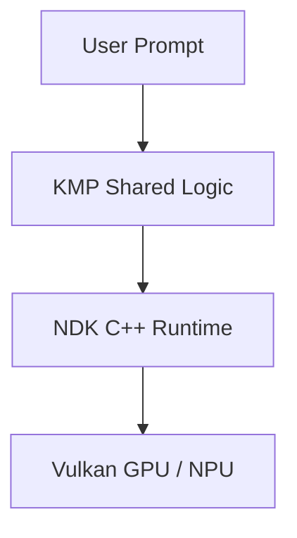

# Article Authoring & Publishing Guide

This guide describes the workflow for drafting, previewing, and publishing technical articles, architectural case studies, and engineering series on **DearDhruv.com**.

---

## 1. Directory Structure & Naming Conventions

All articles live under the `content/posts/` directory.

### Single Standalone Articles
Place standalone articles directly in `content/posts/`:
```text
content/posts/
├── _index.md
└── my-new-article.md
```
URL produced: `https://deardhruv.com/posts/my-new-article/`

### Multi-Part Engineering Series
Place series articles in a designated subfolder with a series index:
```text
content/posts/my-series-name/
├── _index.md
├── 01-first-part.md
├── 02-second-part.md
└── 03-third-part.md
```
URL produced:
- Landing page: `https://deardhruv.com/posts/my-series-name/`
- Parts: `https://deardhruv.com/posts/my-series-name/01-first-part/`

> [!IMPORTANT]
> Always use lowercase kebab-case for filenames and slugs. Never include dates or random hashes in post filenames.

---

## 2. Front Matter Specification

Every Markdown post must begin with TOML front matter (`+++` delimiters):

```toml
+++
title = "Architecting On-Device LLM Inference with C++20 and KMP"
date = "2026-10-31T12:00:00+05:30"
description = "How to build a zero-cloud mobile inference workstation with bounded memory and hardware sandboxing."
tags = ["Android", "Kotlin Multiplatform", "On-Device AI", "C++", "NDK", "llama.cpp"]
series = ["Beyond the Model"]
draft = false
[author]
  name = "Dhruv Patel"
+++
```

### Front Matter Fields
| Field | Type | Description | Required |
|---|---|---|---|
| `title` | String | Full title of the article | Yes |
| `date` | ISO 8601 String | Publication timestamp with timezone offset (`YYYY-MM-DDTHH:MM:SS+05:30`) | Yes |
| `description` | String | 1–2 sentence summary used for SEO, cards, and RSS feeds | Yes |
| `tags` | Array of Strings | Topic taxonomy tags | Yes |
| `series` | Array of Strings | Name of the series if part of a collection | Optional |
| `draft` | Boolean | Set `true` while drafting; set `false` to publish | Yes |
| `[author]` | Object | Author block, `name = "Dhruv Patel"` | Yes |

---

## 3. Creating a New Post

You can use the automated helper script to scaffold a new article safely without overwriting existing files:

```bash
# Interactive or parameterized post creation
node scripts/new-post.js "My New Post Title"
```

Or manually use the Hugo archetype:
```bash
hugo new posts/my-new-article.md
```

---

## 4. Rich Media & Diagrams

### 1. Code Blocks
Always specify the language identifier on triple backticks for syntax highlighting:
````markdown
```kotlin
val runtime = LlamaCppRuntime(context)
runtime.initialize()
```
````
Hugo Chroma automatically formats the code, and our client-side script attaches an accessible keyboard-navigable copy button.

### 2. Mermaid Architecture Diagrams
To insert interactive diagrams that automatically adapt to light/dark mode:
````markdown

````

### 3. Images & Screenshots
Store article assets in `static/images/posts/` and reference them with leading slashes:
```markdown

```
- Use compressed PNGs or WebP.
- Always provide descriptive, accessible `alt` text.

---

## 5. Local Preview & Validation

Run the Hugo development server with draft rendering:
```bash
hugo server -D
```
Open [http://localhost:1313/](http://localhost:1313/) to review changes live.

### Pre-Commit Verification Gate
Before pushing or creating a pull request, run the verification suite:
```bash
# 1. Clean build and asset fingerprinting
hugo --gc --minify

# 2. Automated legacy route regression check (must be 38/38)
node scripts/verify-routes.js

# 3. Static document and download asset integrity check
node tests/verify-assets.js
```

---

## 6. Commit & Deployment Procedure

1. Stage only the new article file:
   ```bash
   git add content/posts/my-new-article.md
   git commit -m "feat(blog): publish my new article title"
   ```
2. Push your feature branch:
   ```bash
   git push origin feature/my-article-topic
   ```
3. Open a Pull Request on GitHub. Netlify will automatically create an isolated **Deploy Preview**.
4. Test the deploy preview in your browser and verify the live Markdown endpoint:
   ```bash
   curl -H "Accept: text/markdown" https://deploy-preview-xxx--deardhruv.netlify.app/posts/my-new-article/
   ```
5. Merge into `master` after review. Production deploys automatically in ~30 seconds.
